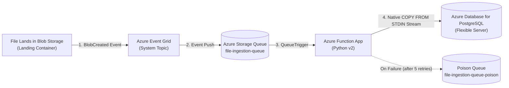
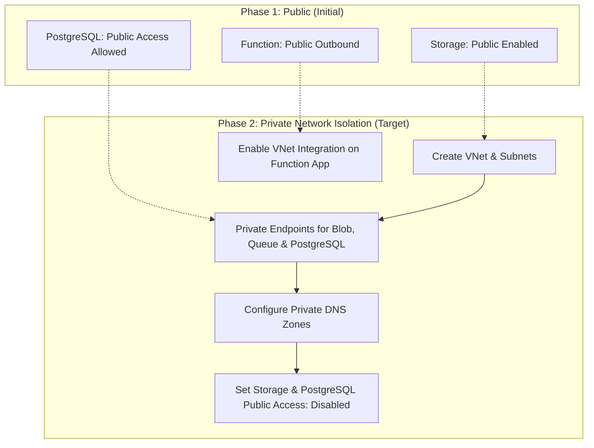

# Event-Driven Azure Storage Ingestion into PostgreSQL Analytics Database

An end-to-end, resilient, and highly cost-effective architecture for automatically migrating and ingesting data into **Azure Database for PostgreSQL Flexible Server** whenever files land in an Azure Storage container.

This project implements a **Queue-Buffered Serverless Event Pattern**:
1. Files (CSV, Parquet, JSON) land in an Azure Storage Container (`raw-landing`).
2. Azure Event Grid detects the `Microsoft.Storage.BlobCreated` event.
3. Event Grid pushes the event into an **Azure Storage Queue** (`file-ingestion-queue`).
4. An **Azure Function App** with a `QueueTrigger` reads the queue message, extracts the blob URL, and executes a high-speed native PostgreSQL `COPY ... FROM STDIN` streaming bulk insert into the target analytics table.
5. Built with a two-phase rollout: **Phase 1 (Public Access)** for rapid initial deployment, and **Phase 2 (Private Endpoints & VNet)** for enterprise network isolation.

---

## 1. Why PostgreSQL for Analytics? (Cost & Performance Evaluation)

| Metric | Azure PostgreSQL Flexible Server | Azure Synapse / Snowflake / Databricks |
| :--- | :--- | :--- |
| **Minimum Monthly Cost** | **~\$15 - \$30/month** (Burstable `B1ms` / `B2s` tier) | **\$300 - \$1,000+/month** (Dedicated DW / Warehouse minimums) |
| **Ingestion Speed** | **Ultra-Fast via native `COPY FROM STDIN`** | Fast via external stages / polybase |
| **Analytics Fit** | **Ideal for operational analytics, dashboards, and workloads up to ~1-2 TB** | Suited for massive multi-terabyte / petabyte enterprise data lakes |
| **Indexing Power** | **B-tree, BRIN, GIN, GiST, Partitioning** | Columnar micro-partitions, cluster keys |
| **Ecosystem & Tooling** | Connects out-of-the-box to Grafana, PowerBI, Metabase, Python, dbt | Proprietary connectors or higher licensing |

> [!TIP]
> **Analytics Optimization in PostgreSQL**:
> * **BRIN (Block Range Index)**: For append-only time-series or sequential data, BRIN indexes take a fraction of the RAM/disk space of standard B-tree indexes and yield blazing fast analytical range scans.
> * **Native Table Partitioning**: Partition the analytics table by month or year to prune older data and maintain sub-second query speeds.
> * **DuckDB / Columnar Extension (`pg_analytics`)**: Can be added for pure columnar performance if analytical aggregation scales up.

---

## 2. Architecture Diagram



---

## 3. Recommended PostgreSQL Table Schema

Connect to your PostgreSQL database (`analyticsdb`) and create your analytics table:

```sql
-- Create analytics landing table
CREATE TABLE IF NOT EXISTS analytics_landing (
    id SERIAL,
    record_timestamp TIMESTAMPTZ DEFAULT CURRENT_TIMESTAMP,
    device_id VARCHAR(50),
    metric_name VARCHAR(100),
    metric_value NUMERIC(12, 4),
    raw_payload JSONB,
    source_file VARCHAR(255)
);

-- Optimization: BRIN index on timestamp for high-performance analytical queries
CREATE INDEX IF NOT EXISTS idx_analytics_timestamp_brin 
ON analytics_landing USING BRIN (record_timestamp);

-- Optional: Index for filtering by metric or device
CREATE INDEX IF NOT EXISTS idx_analytics_device_id 
ON analytics_landing (device_id);
```

---

## 4. Repository Structure

```
├── .gitignore
├── README.md
├── function/
│   ├── function_app.py            # Azure Functions v2 Python logic (QueueTrigger & Postgres COPY)
│   ├── host.json                  # Queue batching, visibility timeout, concurrency config
│   ├── requirements.txt           # Python dependencies (psycopg2-binary, pyarrow, azure-sdk)
│   └── local.settings.json.example# Local development environment configuration
└── scripts/
    ├── setup-public-ingestion.ps1 # Phase 1: PowerShell deployment script (Public mode)
    ├── setup-public-ingestion.sh  # Phase 1: Bash deployment script (Public mode)
    ├── migrate-to-private.ps1     # Phase 2: PowerShell transition script (Private mode)
    └── migrate-to-private.sh      # Phase 2: Bash transition script (Private mode)
```

---

## 5. Quick Start: Phase 1 (Public Mode)

### Prerequisites
* Azure CLI installed (`az login`)
* Python 3.10 or 3.11

### Deploy Public Infrastructure
Run the setup script to provision the Storage Account, Container, Queue, Event Grid subscription, and Azure Database for PostgreSQL Flexible Server:

**PowerShell (Windows):**
```powershell
.\scripts\setup-public-ingestion.ps1 `
    -ResourceGroupName "rg-data-ingestion" `
    -Location "eastus" `
    -StorageAccountName "stdataingest01" `
    -ContainerName "raw-landing" `
    -QueueName "file-ingestion-queue" `
    -PostgresServerName "pg-analytics-01" `
    -PostgresAdminUser "pgadmin" `
    -PostgresAdminPassword "YourStrongPassword123!"
```

**Bash (Linux / macOS):**
```bash
chmod +x ./scripts/setup-public-ingestion.sh
./scripts/setup-public-ingestion.sh "rg-data-ingestion" "eastus" "stdataingest01" "raw-landing" "file-ingestion-queue" "pg-analytics-01" "pgadmin" "YourStrongPassword123!"
```

---

## 6. How the PostgreSQL Ingestion Works

In `function/function_app.py`, the ingestion avoids high memory usage by leveraging PostgreSQL's native streaming `COPY` protocol:

```python
with get_postgres_connection() as conn:
    with conn.cursor() as cursor:
        # Stream CSV or Parquet data directly into Postgres
        cursor.copy_expert(
            sql=f"COPY {TARGET_TABLE} FROM STDIN WITH (FORMAT csv, HEADER true, DELIMITER ',');",
            file=csv_buffer
        )
        conn.commit()
```

* **Zero Memory Bloat**: Files stream through memory buffers directly to PostgreSQL sockets.
* **ACID Transactions**: Each file load is wrapped in an explicit transaction (`conn.commit()`). If loading fails midway, the transaction rolls back cleanly, avoiding duplicate or corrupt records.
* **Automatic Retry**: If a database connection error occurs, the message stays in the queue and retries up to 5 times.

---

## 7. Phase 2: Transitioning from Public to Private

When you are ready to isolate all infrastructure inside a Virtual Network with Private Endpoints:



### Run Private Migration Script
**PowerShell:**
```powershell
.\scripts\migrate-to-private.ps1 `
    -ResourceGroupName "rg-data-ingestion" `
    -Location "eastus" `
    -StorageAccountName "stdataingest01" `
    -PostgresServerName "pg-analytics-01" `
    -VNetName "vnet-ingestion"
```

**Bash:**
```bash
chmod +x ./scripts/migrate-to-private.sh
./scripts/migrate-to-private.sh "rg-data-ingestion" "eastus" "stdataingest01" "pg-analytics-01" "vnet-ingestion"
```
