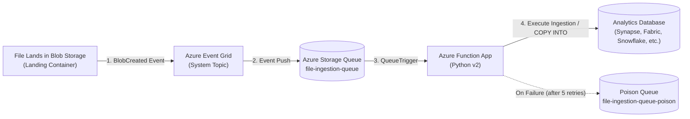
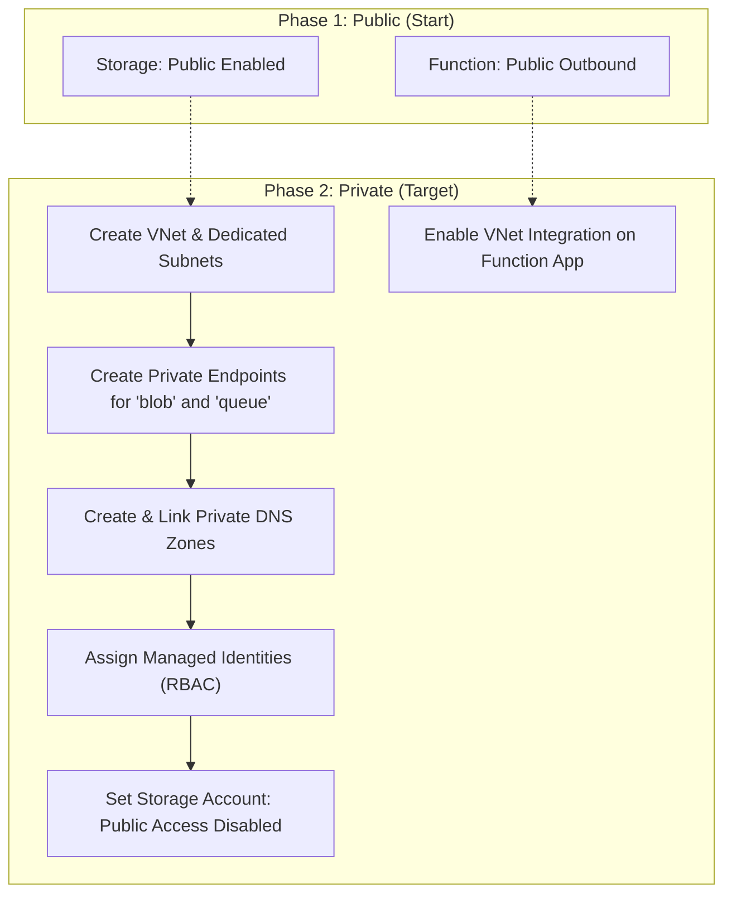

# Event-Driven Azure Storage Ingestion Pipeline

An end-to-end, cost-effective, and resilient architecture for automatically ingesting data into an analytics database whenever files land in an Azure Storage container.

This project implements a **Queue-Buffered Serverless Event Pattern**:
1. Files land in an Azure Storage Container.
2. Azure Event Grid detects the `Microsoft.Storage.BlobCreated` event.
3. Event Grid pushes the event into an **Azure Storage Queue**.
4. An **Azure Function App** with a `QueueTrigger` reads the queue message, extracts the blob URL, and triggers native database bulk ingestion.
5. Built with a two-phase rollout: **Phase 1 (Public Access)** for rapid development, and **Phase 2 (Private Endpoints & VNet)** for enterprise network isolation.

---

## 1. Architecture



### Why Use a Storage Queue Between Event Grid and Function App?
* **Decoupling & Throttling Protection**: If 5,000 files land in 10 seconds, the queue buffers the events without exhausting database connection pools or CPU limits.
* **Cost Efficiency**: Azure Functions Consumption plan provides 1M executions free per month; storage queue transactions cost pennies per million.
* **Automatic Retry & Dead-Lettering**: Azure Functions automatically retries failed events up to 5 times (configurable in `host.json`). Poison messages move to `file-ingestion-queue-poison` for investigation without data loss.

---

## 2. Repository Structure

```
├── .gitignore
├── README.md
├── function/
│   ├── function_app.py            # Azure Functions v2 Python logic (QueueTrigger)
│   ├── host.json                  # Queue batching, visibility timeout, concurrency config
│   ├── requirements.txt           # Python dependencies
│   └── local.settings.json.example# Local development environment configuration
└── scripts/
    ├── setup-public-ingestion.ps1 # Phase 1: PowerShell deployment script (Public mode)
    ├── setup-public-ingestion.sh  # Phase 1: Bash deployment script (Public mode)
    ├── migrate-to-private.ps1     # Phase 2: PowerShell transition script (Private mode)
    └── migrate-to-private.sh      # Phase 2: Bash transition script (Private mode)
```

---

## 3. Quick Start: Phase 1 (Public Mode)

### Prerequisites
* Azure CLI installed (`az login`)
* Azure Functions Core Tools v4 (optional, for local testing)
* Python 3.10 or 3.11

### Deploy Public Infrastructure
Run the setup script to create the Resource Group, Storage Account, Container, Queue, and Event Grid subscription:

**PowerShell (Windows):**
```powershell
.\scripts\setup-public-ingestion.ps1 `
    -ResourceGroupName "rg-data-ingestion" `
    -Location "eastus" `
    -StorageAccountName "stdataingest01" `
    -ContainerName "raw-landing" `
    -QueueName "file-ingestion-queue"
```

**Bash (Linux / macOS):**
```bash
chmod +x ./scripts/setup-public-ingestion.sh
./scripts/setup-public-ingestion.sh "rg-data-ingestion" "eastus" "stdataingest01" "raw-landing" "file-ingestion-queue"
```

---

## 4. Function App Implementation Details

The Function App (`function/function_app.py`) uses Azure Functions Python Programming Model v2:

```python
@app.queue_trigger(
    arg_name="msg",
    queue_name=QUEUE_NAME,
    connection=CONNECTION_SETTING
)
def process_storage_event(msg: func.QueueMessage) -> None:
    # 1. Parse Event Grid JSON payload
    event = json.loads(msg.get_body().decode("utf-8"))
    
    # 2. Extract blob URL & metadata
    blob_url = event["data"]["url"]
    
    # 3. Call database ingestion logic
    ingest_file_to_analytics_db(blob_url)
```

### Database Ingestion Best Practice
Do **not** read large files into Function memory. Instead, execute the target database's native bulk load:
* **Azure Synapse / Fabric / Azure SQL**: Run `COPY INTO` via T-SQL.
* **Snowflake**: Trigger Snowpipe or run `COPY INTO target_table FROM @azure_stage`.
* **PostgreSQL / ClickHouse**: Issue native `COPY` / bulk import stream.

---

## 5. Phase 2: Transitioning from Public to Private

When you are ready to secure the storage account and restrict access to private endpoints inside a Virtual Network:



### Run Migration Script
**PowerShell:**
```powershell
.\scripts\migrate-to-private.ps1 `
    -ResourceGroupName "rg-data-ingestion" `
    -Location "eastus" `
    -StorageAccountName "stdataingest01" `
    -VNetName "vnet-ingestion"
```

**Bash:**
```bash
chmod +x ./scripts/migrate-to-private.sh
./scripts/migrate-to-private.sh "rg-data-ingestion" "eastus" "stdataingest01" "vnet-ingestion"
```

### Key Considerations for Private Mode
1. **Azure Functions Plan**: Standard Consumption plan cannot join a VNet. For private endpoints, host the Function App on **Flex Consumption** or **Premium Plan (EP1)**.
2. **Authentication**: Use **System-Assigned Managed Identity** for both Event Grid and the Function App. Grant:
   * Event Grid System Topic: `Storage Queue Data Message Sender`
   * Function App: `Storage Queue Data Message Processor` and `Storage Blob Data Reader`
3. **Private DNS Zones**: Ensure `privatelink.blob.core.windows.net` and `privatelink.queue.core.windows.net` are linked to your VNet so DNS resolves directly to private IP addresses.
